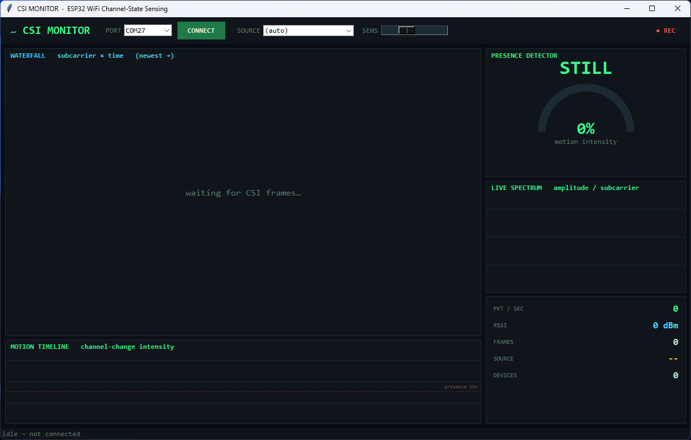

# CSI Monitor — WiFi Channel-State Sensing on ESP32

Turn an ESP32 into a **device-free WiFi motion sensor** and watch it work in a live
desktop dashboard. The ESP32 reports **Channel State Information (CSI)** — per-subcarrier
amplitude/phase of the WiFi channel — for every packet it receives. When a person moves
near the radio path, the multipath shifts and the CSI wobbles. That wobble *is* the sensor.



## What's here

| File | What it does |
|------|--------------|
| `csi_monitor.py` | The live GUI dashboard (tkinter, stdlib-only + pyserial). Waterfall heatmap, live spectrum, motion timeline, presence detector, per-device selector, adjustable **SENS**/**TRIG**, CSV recording. |
| `capture_csi.py` | Headless capture — logs parsed CSI frames to JSON for offline analysis. |
| `CSI_Monitor.exe` | Portable Windows build (no Python needed). See Releases. |

## The rig

- **Receiver (AP):** an ESP32 running [ESP32-CSI-Tool](https://github.com/StevenMHernandez/ESP32-CSI-Tool) `active_ap`, flashed via ESP-IDF **v4.3**. It creates a softAP, collects CSI from every frame it receives, and prints `CSI_DATA,...` lines over serial at 921600 baud.
- **Transmitter(s):** *anything that sends WiFi packets to that AP* — a phone, a laptop, or a dedicated ESP32 running `active_sta`. More traffic = denser CSI. (Phones go silent when the screen locks; keep them awake or run a steady `ping 192.168.4.1`.)
- **This app:** reads the AP's serial stream, parses the CSI array, and visualizes it.

## CSI frame format

Each line: `CSI_DATA,role,mac,rssi,rate,...,local_timestamp,...,[imag real imag real ...]`

The bracketed array is interleaved imaginary/real pairs per OFDM subcarrier.
Amplitude per subcarrier = `sqrt(real² + imag²)`.

## Run it

```bash
# portable exe (Windows): just double-click CSI_Monitor.exe
# or from source:
pip install pyserial
python csi_monitor.py
```

Pick the AP's COM port, hit **CONNECT**, make sure something is transmitting to the AP,
and move around. The **MOTION TIMELINE** spikes on movement; **TRIG** sets the presence
fire-line; **SENS** scales the raw motion reading.

## Honest limits

A single receive antenna detects **that** motion is happening nearby — it **cannot** tell
direction or distance to a person (that needs a multi-antenna array, FTM ranging, or
multiple anchors for multilateration — or a purpose-built 60 GHz mmWave radar module like
the HLK-LD2450). This tool is honest motion/presence sensing, not positional radar.

## Build the exe

```bash
pip install pyserial pyinstaller
pyinstaller --onefile --windowed --name CSI_Monitor csi_monitor.py
```
